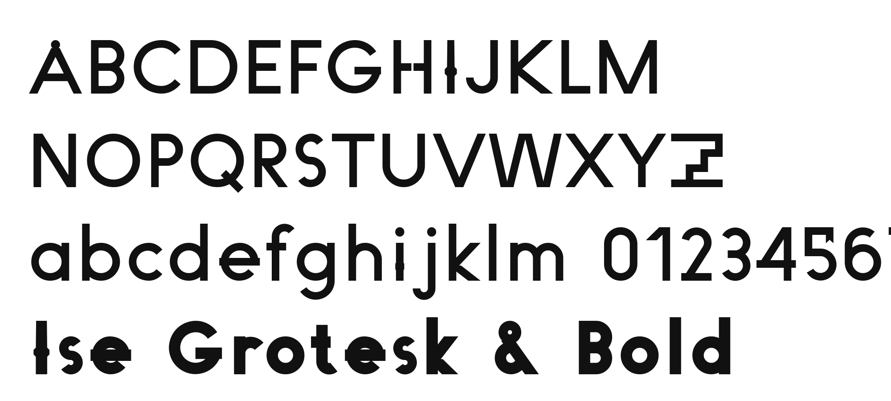
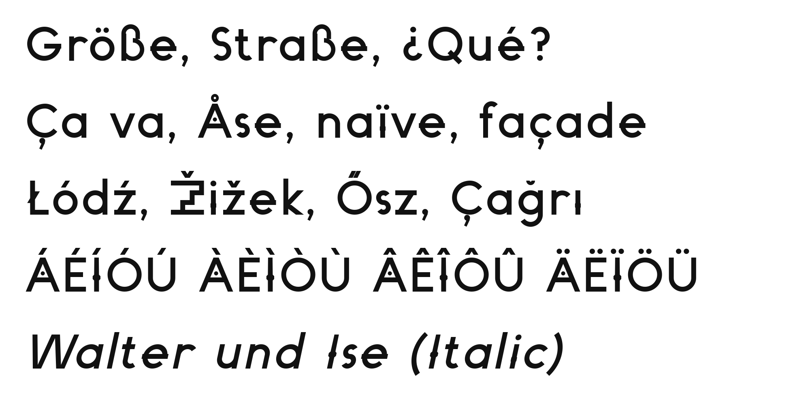

# Ise Grotesk

A geometric sans-serif inspired by the design principles of Walter Gropius and the Bauhaus: function over ornament, geometric primitives, and a modular grid.

> Status: **v0.1.0 release candidate (draft: A-Z, a-z, 0-9, punctuation, symbols, ~150 accented letters for Western European and Latin Extended-A languages, ss01 "Logic" and ss02 "Clear" sets)**. Four styles: Regular, Italic, Bold and Bold Italic, in TTF, OTF and WOFF2.

**Accessibility:** Ise Grotesk is a *display* face (24pt and up). Turn on `ss02` (Clear) for tailed l, slab I, slashed zero and spurred b d p q. Accented capitals sit above cap height, so use generous line spacing. Check text/background contrast (WCAG 4.5:1 minimum).





## Dedication

*For the un-sung women in design.*

Ise Gropius (1897-1983), born Ilse Frank, was known as "Frau Bauhaus." She worked beside Walter Gropius as his secretary, editor, co-author and ghost writer, and her diaries of 1923 to 1928 are a key record of the early Bauhaus years. When the family left Germany, her English made her his voice. History often files her under "wife of." This typeface is named for her, one of the many women whose work shaped modern design, and it carries the principles they shared: clarity, function, and no ornament.

"Grotesk" is the German word for sans-serif. The name is pronounced roughly *EE-zuh*.

## Repo layout
- `sources/`: editable font sources (UFO)
- `scripts/make_glyphs.py`: generates glyphs from the grid (A-Z, a-z, 0-9, punctuation, spacing table and kerning)
- `release/`: the fonts, as TTF, OTF and WOFF2
- `docs/WHIMSY_LETTERS.md`: the stories behind the story letters (A, H, I, W, Z, 5, i, w, &)

## Build
```
pip install fonttools fontmake
python scripts/make_glyphs.py   # optional: python scripts/preview.py
./build.sh                      # fontmake: TTF + OTF with overlap removal (release build)
./build_all.sh                  # fontTools-only test TTFs for all four styles, no extra installs
```

## License
SIL Open Font License 1.1. Add the full text as `OFL.txt` (copy from https://openfontlicense.org and fill in your name and the font name).
